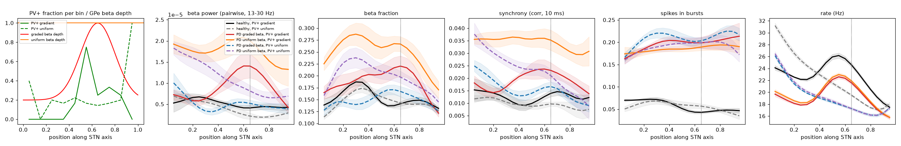

# Where does the upper-middle beta peak come from? GPe beta gradient vs PV+ gradient, 2026-10-26

This uses the current default network (model state: commit `630021c`): topographic GPe<->STN, equal Kir,
Kv3.1 PV+ 1.2 / PV- 1.15, cortex 0.8 nS, parkinsonian GPe->STN synapse scale 2.0.

The design is 2 x 2, with 5 seeds x 3 s per condition (`sweeps/beta_pvp_layout.py`):

| | PV+ gradient (default) | PV+ uniform |
|---|---|---|
| **GPe beta depth** | | |
| graded (default): 1.0 at axis 0.65, width 0.15, 0.2 elsewhere | `untreated` | `pd_pvpuni` |
| uniform: `gpe_params = {'beta_width': 1e9}`, depth 1.0 everywhere | `pd_unibeta` | `pd_unibeta_pvpuni` |

Healthy references were run with both PV+ placements (`healthy`, `healthy_pvpuni`).
- **PV+ gradient** (`tools.generate_locs`): the 12 PV+ cells are concentrated around axis
  ~0.5-0.8, skew-normal peak at grid 0.67.
- **PV+ uniform** (`cfg.pvp_placement = 'uniform'`): PV+ cells are 20% of every grid. The total cells
  per grid are the same, so only the PV+ / PV- mix changes; cell positions are re-drawn.
- With uniform beta depth, the total pallidal beta drive is larger, since every group gets the peak
  depth.
- The cortical input gradient (stronger ventrally, `cfg.ctx_topography`) is the same everywhere.

The healthy and graded-beta / PV+ gradient runs are those of `sweeps/kv31_combos.py`, seeds 1-5.

Files:
- `summary.csv`, `summary.png` and `psd.png`: per-condition metrics and spectra.
- `profiles.png`: first panel shows the PV+ fraction per axis bin (seed 1) and the GPe beta depth;
  the other panels show axis profiles, mean +- SEM.

## Results

| condition | beta pow | sync | PV+ / PV- rate (Hz) | bursts | beta power peak, per seed | beta 0.65 / 0.25 (mean profile) | sync 0.65 / 0.25 |
|---|---|---|---|---|---|---|---|
| healthy, PV+ gradient | 0.024 | 0.009 | 38 / 19 | 0.052 | scattered | 0.61 | 1.05 |
| healthy, PV+ uniform | 0.022 | 0.009 | 40 / 19 | 0.050 | 0.05-0.3 | 0.38 | 0.85 |
| **PD graded beta, PV+ gradient** | 0.036 | 0.016 | 34 / 16 | 0.18 | **0.60, 0.65, 0.60, 0.75, 0.60** | **2.43** | **1.56** |
| PD uniform beta, PV+ gradient | **0.067** | **0.033** | 34 / 16 | 0.17 | 0.05, 0.05, 0.50, 0.05, 0.55 | 1.17 | 0.99 |
| PD graded beta, PV+ uniform | 0.024 | 0.014 | 35 / 16 | 0.18 | 0.05, 0.05, 0.95, 0.05, 0.05 | 1.25 | 0.98 |
| PD uniform beta, PV+ uniform | 0.046 | 0.021 | 35 / 16 | 0.17 | 0.05, 0.30, 0.05, 0.05, 0.15 | 0.53 | 0.74 |

## Interpretation

- **The upper-middle beta and synchrony peak needs both gradients.** Only graded GPe beta together
  with the PV+ cluster gives a consistent peak at 0.60-0.65 (5 / 5 seeds) and a ~2.4x upper-middle
  vs lower-middle beta ratio. Removing either one abolishes the peak.
- **Uniform GPe beta depth (PV+ gradient kept):**
  - STN beta power doubles and synchrony is 2x higher, because the total pallidal beta drive is larger.
  - Beta is spread along the whole axis, highest at the ventral end. Only a weak hump remains around
    0.6 in the mean profile; per-seed peaks are mostly at the ventral edge.
  - So the PV+ cluster alone does not localize beta when the drive is uniform.
- **Uniformly placed PV+ (graded GPe beta kept):**
  - Total STN beta power falls to the healthy level (0.024), although the GPe beta drive is
    unchanged. Synchrony and bursting stay parkinsonian.
  - The remaining beta peaks at the ventral end, where cortical input is strongest.
  - So PV+ cells are the main amplifiers of the pallidal beta: the graded drive produces strong STN
    beta only where it meets a cluster of PV+ (rebound-bursting) cells.
- **With both uniform**, beta is intermediate (0.046) and follows the cortical gradient (ventral peak).
- **Bursting** is ~0.17-0.18 in all four PD conditions. It is set by the strength of GPe inhibition,
  not by where beta or PV+ cells are. Firing rates are also unchanged, apart from the PV+-driven rate
  bump at 0.5-0.6 with the PV+ gradient.
- Caveats:
  - With only 12 PV+ cells, the "uniform" placement is coarse.
  - Peaks at the ventral edge sit where n_eff is ~10 cells, so they are less certain than mid-axis
    peaks.
