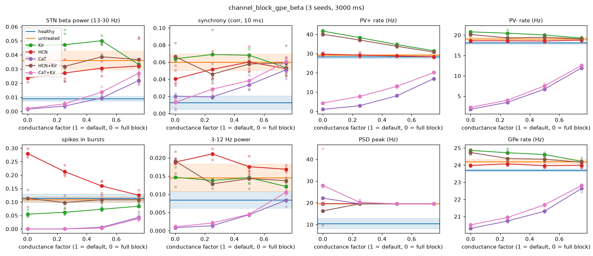

# HCN, CaT and Kir block, alone and combined (GPe-beta network), 2026-10-17

Parkinsonian network with input_version 2 (GPe is the primary beta source; see
`results/kir_sweep_gpe_beta/`). Each block factor f multiplies that conductance in all STN cells
(`cfg.channel_block`); combinations block both channels by the same factor. 3 seeds x 3 s per
condition, metrics from t >= 0.5 s. The healthy, untreated and Kir-only runs are those of
`sweeps/kir_block_gpe_beta.py`. Reproduce with `python src/sweep.py run sweeps/channel_block_gpe_beta.py`
(model state: commit `734de37`).

Files: `metrics.png` / `psd.png` (all conditions), `summary.csv` (means and SDs),
`gap_closed.csv` (fraction of the parkinsonian-healthy gap closed per metric),
`single_cell_PV*_gHCN.png` (isolated-cell HCN sweeps).

## Results

Gap closed: 1 = back to healthy, 0 = untreated parkinsonian, < 0 = further away. Beta power scales
with firing rate, so the rate-independent **beta fraction** (13-30 Hz share of 1-100 Hz power) is
shown too.

| condition | beta power gap | beta fraction gap | synchrony gap | PV+ / PV- rate (Hz) | spikes in bursts |
|---|---|---|---|---|---|
| healthy | 1 | 1 | 1 | 28 / 18 | 0.11 |
| untreated parkinsonian | 0 | 0 | 0 | 29 / 19 | 0.11 |
| Kir 0.5 / 0 | -0.52 / -0.39 | -0.22 / -0.05 | -0.18 / -0.09 | 35 / 20, 42 / 21 | 0.07, 0.05 |
| HCN 0.75 | 0.14 | 0.24 | 0.15 | 28 / 19 | 0.13 |
| HCN 0.5 | 0.20 | 0.24 | -0.01 | 29 / 19 | 0.16 |
| HCN 0.25 | 0.32 | 0.38 | 0.17 | 29 / 19 | 0.21 |
| **HCN 0** | **0.46** | **0.46** | **0.41** | **30 / 19** | **0.28** |
| CaT 0.75 | 0.52 | 0.03 | 0.18 | 17 / 12 | 0.04 |
| CaT 0.5 | 0.98 | 0.29 | 0.55 | 8 / 7 | 0.01 |
| CaT 0.25 / 0 | 1.19 / 1.27 | 0.41 / 0.49 | 0.86 / 0.84 | 3 / 3, 1 / 2 | 0 |
| HCN+Kir 0.75 ... 0 | -0.10 to 0.15 | 0.07 to 0.23 | -0.14 to 0.29 | 31-40 / 19-20 | 0.10-0.11 |
| CaT+Kir 0.75 | 0.33 | -0.02 | -0.02 | 20 / 13 | 0.04 |
| CaT+Kir 0.5 | 0.83 | 0.10 | 0.45 | 13 / 8 | 0.00 |
| CaT+Kir 0.25 / 0 | 1.13 / 1.26 | 0.40 / 0.65 | 0.66 / 0.99 | 8 / 4, 4 / 2 | 0 |

## Interpretation

- **CaT block** reduces beta power mostly by silencing STN: at 25% block the beta fraction is
  unchanged while rates fall ~40% below healthy; deeper block lowers the beta fraction only once STN
  fires at 1-8 Hz. CaT carries the cells' pacemaking (cf. PV- cells silent at low CaT), so this is
  suppression, not normalization.
- **HCN block** is the only rate-neutral improvement: full block closes ~45% of the gap in beta
  (power and fraction) and ~40% in synchrony at unchanged rates, but the burst metric rises to 2.5x
  healthy. In isolated cells, HCN block leaves spontaneous rate (PV+ 16-17 Hz) and rebound bursts
  (14-15 spikes) unchanged but makes pacemaking irregular (ISI CV 0.01 -> 0.49 in PV+) and abolishes
  PV+ rhythmic bursting at -0.16 nA: irregular pacemakers phase-lock less to the beta-modulated GPe
  inhibition. The higher network burst count likely reflects this irregular firing (spike clusters)
  rather than rebound bursting.
- **Kir block** worsens beta and raises rates (see `results/kir_sweep_gpe_beta/`). Combined with
  HCN block it cancels HCN's benefit (rates up to 40 Hz, synchrony not reduced); combined with CaT
  block it partly offsets the rate loss but also the beta-fraction benefit.

No single block or Kir combination restores the parkinsonian network to healthy: the best candidate,
HCN block, halves the excess beta and synchrony at the cost of more irregular, clustered firing.
