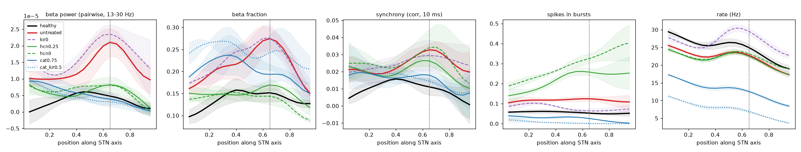

# HCN, CaT and Kir block on the topographic parkinsonian network, 2026-10-25

This is the network of `results/topo_pd_state/` (input_version 3: topographic GPe<->STN, parkinsonian
beta strongest at axis 0.65, PD GPe->STN synapse x1.5). It uses the raised Kv3.1 defaults
(PV+ 1.2, PV- 1.15; see `results/kv31_single_cell/`) and cortex at 0.8 nS (model state: commit `45f6e04`).

Each block factor f multiplies that conductance in all STN cells (`cfg.channel_block`).
Combinations block both channels by the same f. Each condition is 3 seeds x 3 s, with metrics from
t >= 0.5 s.

Reproduce with `python src/sweep.py run sweeps/channel_block_topo.py`. The healthy and untreated runs
are the `ctx0.8` runs of `sweeps/kv31_topo_calib.py` (identical settings).

Files:
- `summary.csv`, `summary.png` and `psd.png`: all conditions.
- `profiles.png`: axis profiles of selected conditions (mean +- SD over seeds).
- `profiles_all.png`: all conditions.
- `kv31_calib_*`: the cortical calibration after the Kv3.1 change (cortex 0.7 vs 0.8 nS).

## Calibration with the new Kv3.1 (`sweeps/kv31_topo_calib.py`)

| cortex | state | beta pow | sync | PV+ / PV- rate | bursts | beta peak (axis), per seed |
|---|---|---|---|---|---|---|
| 0.7 nS | healthy / PD | 0.023 / 0.041 | 0.010 / 0.021 | 30 / 22, 28 / 19 | 0.050 / 0.107 | PD 0.65, 0.05, 0.65 |
| **0.8 nS** | healthy / PD | 0.024 / 0.051 | 0.010 / 0.021 | 32 / 24, 30 / 21 | 0.055 / 0.115 | PD **0.65, 0.70, 0.60** |

With 0.8 nS, rates match the pre-Kv3.1 calibration, and the parkinsonian upper-middle beta peak is
present in every seed. The mean synchrony profile also peaks at ~0.65. Single-seed synchrony maxima at
the axis ends (0.05) are noise: n_eff is ~6-10 cells there.

## Results

"Gap closed" is 1 when the metric is back to healthy, 0 when it equals untreated parkinsonian, and < 0
when it moves further away. Beta power scales with rate, so the rate-independent **beta fraction**
(13-30 Hz share of 1-100 Hz) is also given. The "@0.65" columns are the axis profile at the
upper-middle STN, where the parkinsonian beta peaks.

| condition | beta pow gap | beta frac gap | beta frac @0.65 gap | sync gap | sync @0.65 gap | PV+ / PV- rate (Hz) | bursts | beta peak (axis) |
|---|---|---|---|---|---|---|---|---|
| healthy | 1 | 1 | 1 | 1 | 1 | 32 / 24 | 0.055 | ~0.48 |
| untreated PD | 0 | 0 | 0 | 0 | 0 | 30 / 21 | 0.115 | 0.65, 0.70, 0.60 |
| Kir 0.75 | 0.07 | 0.06 | 0.08 | 0.14 | 0.25 | 34 / 21 | 0.093 | 0.60-0.65 |
| Kir 0.5 | -0.25 | 0.05 | 0.14 | -0.25 | -0.15 | 37 / 22 | 0.085 | 0.60-0.65 |
| Kir 0.25 | -0.88 | -0.60 | -0.28 | -0.13 | -0.15 | 41 / 22 | 0.069 | 0.60-0.65 (1 seed edge) |
| Kir 0 | -0.48 | -0.32 | -0.01 | 0.06 | 0.15 | 45 / 23 | 0.067 | 0.65-0.70 |
| HCN 0.75 | 0.35 | 0.21 | 0.35 | 0.25 | 0.26 | 30 / 20 | 0.13 | scattered |
| HCN 0.5 | 0.44 | 0.49 | 0.57 | -0.26 | -0.05 | 29 / 20 | 0.18 | scattered |
| **HCN 0.25** | **0.75** | **0.63** | **0.86** | **0.40** | **0.30** | **31 / 20** | **0.21** | scattered |
| HCN 0 | 0.72 | 0.88 | 1.06 | -0.10 | -0.06 | 31 / 20 | 0.28 | scattered |
| CaT 0.75 | 0.92 | 0.22 | 0.66 | 0.52 | 0.68 | 17 / 12 | 0.030 | lower axis |
| CaT 0.5 | 1.39 | 0.17 | 0.25 | 0.67 | 0.97 | 6 / 6 | 0.009 | |
| CaT 0.25 / 0 | 1.75 / 1.85 | 0.59 / 0.61 | 0.77 / 0.67 | 1.24 / 1.24 | 1.33 / 1.26 | 1.5 / 2.7, 0.3 / 1.2 | ~0 | |
| HCN+Kir 0.5 | -0.42 | -0.24 | -0.28 | -0.45 | -0.38 | 36 / 21 | 0.12 | 0.60-0.65 |
| HCN+Kir 0 | -0.02 | 0.16 | 0.35 | -0.06 | 0.24 | 43 / 22 | 0.15 | 0.60-0.65 |
| CaT+Kir 0.5 | 1.16 | -0.21 | 0.26 | 0.59 | 0.85 | 11 / 7 | 0.008 | lower axis |
| CaT+Kir 0 | 1.80 | 0.50 | 0.69 | 1.60 | 1.42 | 2.3 / 1.6 | 0 | |

## Interpretation

- **Kir block** does not restore the healthy state.
  - It raises PV+ firing (30 -> 45 Hz at full block) while PV- barely changes (21 -> 23 Hz). This
    follows from PV+ carrying 5x the Kir of PV- (`cfg.PVP_gKir_scale` 0.5 vs `PVN` 0.1).
  - Beta power and beta fraction get worse, and the beta peak stays at the upper-middle axis.
  - Bursting falls (0.115 -> 0.07), but this comes from faster tonic firing, not normalization.
- **HCN block** is again the only rate-neutral improvement, and it works better on this network than
  on the all-to-all one (`results/channel_block_gpe_beta/`, full block ~0.45).
  - At 0.25, it closes ~75% of the beta-power gap and ~85% of the upper-middle beta-fraction gap.
    The upper-middle beta hump flattens to healthy level.
  - Synchrony improves less and inconsistently (0.4 at 0.25, none at full block).
  - Burstiness rises steeply (0.21-0.28, 4-5x healthy), more so toward the dorsal end. In isolated
    cells, HCN block makes pacemaking irregular. This is the same trade-off as before, and it moves
    burstiness away from healthy.
- **CaT block** lowers beta power and synchrony by silencing STN.
  - Already at 0.75, rates fall ~45% (17 / 12 Hz), while the beta fraction barely improves (0.22).
  - The remaining beta shifts toward the lower axis.
  - This is suppression, not normalization.
- **Combinations with Kir** dilute the benefit of either partner. HCN+Kir behaves like Kir (PV+ rate
  up, beta peak kept). CaT+Kir behaves like a weaker CaT block.

Conclusion: on the topographic network, as on the all-to-all one, no block of Kir, HCN or CaT
returns the parkinsonian STN to healthy.
- Partial HCN block (0.25-0.5 remaining) best removes the excess beta and the upper-middle beta
  peak at unchanged rates, but at the cost of more irregular, clustered firing.
- Kir block, applied equally to both types, is counterproductive. Its effect is dominated by PV+.
