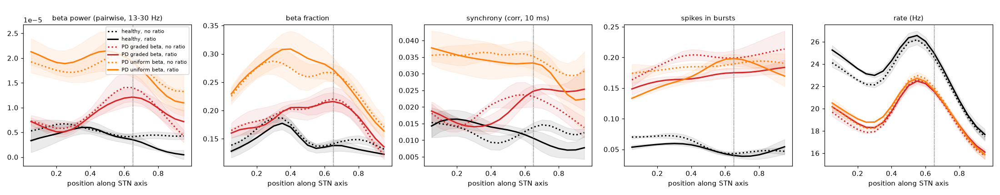

# Per-type GABA:glutamate ratio (PV+ 1.3x PV-), 2026-10-26

`cfg.gpe_gaba_scale = {'PVP': 1.13, 'PVN': 0.87}` (now default) multiplies the GPe->STN (GABA)
conductance per cell type. Cortical (glutamate) input is the same for both types, so PV+ cells get a
1.3x higher GABA:glutamate ratio than PV- cells. The split is symmetric around 1. With 20% PV+ cells,
the cell-weighted mean GPe->STN conductance falls by ~8%.

The network is configuration D, the current default (model state: commit `b3cf1c1`):
- GPe is the beta source, with depth graded along the axis: 1.0 at 0.65, sigma 0.15, 0.2 elsewhere.
- Topographic GPe<->STN: 12 groups, sigma 0.1, 1 nS base.
- Parkinsonian synapse scale 2.0, equal Kir, Kv3.1 PV+ 1.2 / PV- 1.15, cortex 0.8 nS.

Each condition is 5 seeds x 3 s (`sweeps/gaba_ratio.py`). The comparison without the ratio is the same
conditions and seeds of `sweeps/beta_pvp_layout.py`.

Files:
- `summary.csv`, `summary.png` and `psd.png`: per-condition metrics and spectra.
- `profiles.png`: axis profiles; dotted = no ratio, solid = ratio.

## Results (mean +- SD over 5 seeds)

| condition | beta pow | beta frac | sync | PV+ / PV- rate (Hz) | bursts | beta peak per seed | beta 0.65 / 0.25 | sync 0.65 / 0.25 |
|---|---|---|---|---|---|---|---|---|
| healthy, no ratio | 0.024 +- 0.004 | 0.167 | 0.0087 | 38.1 / 19.3 | 0.052 | scattered | 0.61 | 1.05 |
| **healthy, ratio** | 0.024 +- 0.004 | 0.159 | 0.0107 | 37.5 / 20.3 | 0.046 | scattered | 0.68 | 0.66 |
| PD graded beta, no ratio | 0.036 +- 0.009 | 0.239 | 0.0155 | 33.5 / 16.0 | 0.182 | 0.60, 0.65, 0.60, 0.75, 0.60 | 2.43 | 1.56 |
| **PD graded beta, ratio** | 0.035 +- 0.004 | 0.239 | 0.0156 | 32.9 / 16.4 | 0.161 | 0.25, 0.65, 0.95, 0.65, 0.60 | **2.37** | **1.73** |
| PD uniform beta, PV+ gradient, no ratio | 0.067 +- 0.019 | 0.344 | 0.0325 | 34.1 / 16.3 | 0.175 | 0.05, 0.05, 0.50, 0.05, 0.55 | 1.17 | 0.99 |
| **PD uniform beta, PV+ gradient, ratio** | 0.070 +- 0.022 | 0.371 | 0.0293 | 33.2 / 16.7 | 0.166 | 0.05, 0.55, 0.50, 0.05, 0.45 | 1.02 | 0.95 |

## Interpretation

- **Rates are almost unchanged.** PV+ is 0.5-0.6 Hz lower and PV- 0.4-1 Hz higher; no recalibration
  is needed.
- **Healthy and parkinsonian still separate in configuration D with the ratio on.**

  | metric | PD vs healthy |
  |---|---|
  | beta power | 1.5x (0.035 vs 0.024) |
  | beta fraction | 0.24 vs 0.16 |
  | synchrony | 1.5x |
  | bursting | 3.5x (0.161 vs 0.046) |
  | mean-profile beta peak | at 0.65, upper-middle / lower-middle ratio 2.4 (unchanged) |

  - The peak is a little less consistent per seed: 3 / 5 seeds peak at 0.60-0.65, against 5 / 5
    without the ratio. One seed peaks at 0.25 and one at the dorsal edge.
  - PD synchrony now rises dorsally: it plateaus from ~0.65 to the dorsal end instead of peaking at
    0.6.
  - Healthy synchrony falls dorsally, so the PD/healthy synchrony contrast at the upper-middle and
    dorsal STN is larger: 0.65 / 0.25 ratio 1.73 vs 1.56.
  - Bursting is ~12% lower than without the ratio, consistent with weaker inhibition of the more
    numerous PV- cells.
- **Uniform beta drive with the PV+ gradient: still no localized beta peak with the ratio on.** Beta
  power and fraction stay high along the whole axis. The upper-middle / lower-middle ratio is ~1.0, and
  per-seed peaks are at the ventral edge or ~0.5. Giving PV+ cells relatively more inhibition does
  not let the PV+ cluster localize beta by itself. The graded pallidal beta drive is still required
  for the upper-middle peak.
