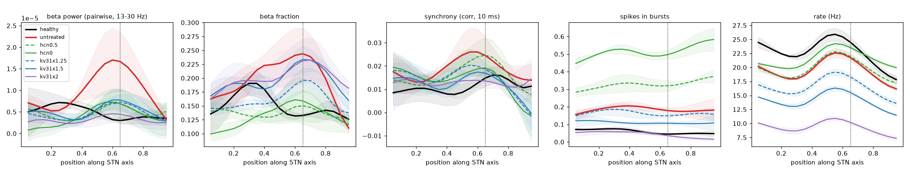

# HCN block and Kv3.1 enhancement as rescue of the parkinsonian STN, 2026-10-25

## Model

The topographic network (input_version 3) with the current defaults (model state: commit `4e0eb7e`):
- Kir 0.3 in both PV+ and PV-, i.e. no asymmetry (`results/kir_equal_single_cell/`).
- Kv3.1 PV+ 1.2 / PV- 1.15.
- Cortex 0.8 nS.
- Parkinsonian GPe->STN synapse scale **2.0**, raised from 1.5 to restore the PD state with equal Kir
  (`results/pd_synapse_calib/`, `sweeps/pd_synapse_calib.py`).

| synapse scale (PD) | beta pow | sync | PV+ / PV- rate (Hz) | bursts | beta peak (axis), per seed |
|---|---|---|---|---|---|
| healthy (1.0) | 0.024 | 0.007 | 38 / 19 | 0.054 | (low hump ~0.25) |
| 1.5 | 0.038 | 0.019 | 35 / 17 | 0.11 | 0.05, 0.60, 0.60 |
| 1.75 | 0.031 | 0.014 | 34 / 16 | 0.14 | 0.05, 0.05, 0.05 |
| **2.0** | **0.037** | **0.015** | **34 / 16** | **0.17** | **0.60, 0.65, 0.60** |
| 2.5 | 0.032 | 0.016 | 33 / 16 | 0.24 | 0.65, 0.60, 0.55 |

At 2.0, beta power and beta fraction peak at the upper-middle STN in every seed, and the synchrony
profile peaks at ~0.55-0.6. The high synchrony at the ventral edge seen at 1.5 is gone. Bursting is
3x healthy. The response to the synapse scale is not monotonic (1.75 has no upper-middle peak), so the
calibration is somewhat seed- and parameter-sensitive.

## Sweep

`sweeps/hcn_kv31_rescue.py`, 3 seeds x 3 s per condition. The healthy and untreated runs are the
healthy / `pd_syn2` runs of the calibration.
- **HCN block**: `channel_block = {'gHCN': f}` with f = 0.75 ... 0.
- **Kv3.1 increase** in all STN cells, like a Kv3.1 opener (e.g. AUT00206):
  `channel_block = {'gKv31': f}` with f = 1.1 ... 2 on top of the default scales.

Files:
- `summary.csv`, `summary.png` and `psd.png`: per-condition metrics and spectra.
- `profiles.png`: axis profiles of selected conditions, mean +- SD over seeds.
- `profiles_all.png`: axis profiles of all conditions.

## Results (gap closed: 1 = healthy, 0 = untreated PD, < 0 = further away)

| condition | beta pow | beta frac | beta frac @0.65 | sync | sync @0.65 | bursts | PV+ / PV- rate (Hz) | spikes in bursts |
|---|---|---|---|---|---|---|---|---|
| healthy | 1 | 1 | 1 | 1 | 1 | 1 | 38 / 19 | 0.054 |
| untreated PD | 0 | 0 | 0 | 0 | 0 | 0 | 34 / 16 | 0.17 |
| HCN 0.75 | 0.29 | 0.32 | 0.42 | -0.19 | 0.15 | -0.39 | 33 / 16 | 0.22 |
| **HCN 0.5** | **1.17** | **1.33** | **0.84** | 0.10 | -0.01 | **-1.01** | 33 / 17 | 0.29 |
| HCN 0.25 | 0.88 | 0.98 | 0.58 | -0.05 | 0.18 | -1.71 | 33 / 18 | 0.38 |
| HCN 0 | 1.09 | 1.20 | 0.76 | 0.25 | 0.55 | -2.48 | 34 / 19 | 0.47 |
| Kv3.1 x1.1 | -0.01 | -0.22 | 0.29 | -0.04 | 0.08 | 0.21 | 32 / 15 | 0.15 |
| **Kv3.1 x1.25** | **1.03** | **0.68** | 0.43 | 0.18 | **0.61** | 0.24 | 29 / 14 | 0.14 |
| Kv3.1 x1.5 | 1.03 | 0.11 | 0.09 | 0.41 | 0.78 | 0.54 | 25 / 12 | 0.11 |
| Kv3.1 x2 | 1.55 | 0.12 | 0.12 | 0.38 | 1.13 | 1.00 | 18 / 7 | 0.055 |

## Interpretation

- **HCN block** removes the excess beta at unchanged rates.
  - From 50% block, the beta fraction is back to healthy (gap closed 1.0-1.3 overall, ~0.8 at the
    upper middle), and the upper-middle beta hump disappears.
  - Synchrony is not reliably reduced.
  - Bursting rises steeply, to 0.29-0.47 of spikes in bursts (5-9x healthy), so the burst symptom
    gets much worse. This is the same trade-off as on the earlier networks, and stronger here because
    the stronger GPe inhibition gives more rebound and pause-driven clustering.
- **Kv3.1 increase** is the only intervention tested that moves bursting and synchrony toward healthy
  together.
  - x1.25: beta power is normalized, the beta fraction gap ~0.7 closed, upper-middle synchrony 0.6,
    with a small burst improvement. Rates fall 14% (PV+ 34 -> 29, PV- 16 -> 14 Hz).
  - x1.5-2: bursting and upper-middle synchrony reach healthy at x2, but mostly by lowering
    excitability. Rates fall to 18 / 7 Hz, about half of healthy, and the rate-independent beta
    fraction stays parkinsonian (gap ~0.1). At high doses, the beta power reduction largely reflects
    lower firing, like CaT block.
  - The x1.25 beta-fraction gain is not monotonic in dose (x1.5 shows ~0.1), so treat it as
    uncertain with 3 seeds.
- In this model, PD rates are already slightly below healthy, so the rate cost of Kv3.1
  enhancement moves rates further from healthy.

**Summary.** HCN block and Kv3.1 enhancement act on different symptoms.
- HCN block fixes the beta spectrum but worsens bursting.
- Kv3.1 enhancement fixes bursting and synchrony, at a rate cost that grows with dose.
- A moderate Kv3.1 increase (~x1.25) gives the most balanced improvement: beta power, ~0.6 of
  upper-middle synchrony and a little bursting, for a 14% rate drop.
- Natural next steps:
  - more seeds at x1.25-1.5;
  - partial HCN block combined with Kv3.1 x1.25, which might combine the beta-fraction and burst
    benefits.
