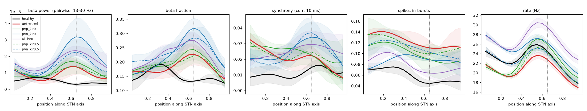

# Per-type Kir block with equal Kir in PV+ and PV-, 2026-10-25

Kir is now 0.3 in both types (previously 0.5 in PV+ and 0.1 in PV-; see
`results/kir_equal_single_cell/`). Everything else is the topographic network of
`results/channel_block_topo/`: input_version 3, Kv3.1 at PV+ 1.2 / PV- 1.15, cortex at 0.8 nS
(model state: commit `47cb398`). Each condition is 3 seeds x 3 s.

- Kir is blocked in PV+ only (`channel_block = {'PVP_gKir': f}`), PV- only (`PVN_gKir`), or both
  (`gKir`).
- Reproduce with `python src/sweep.py run sweeps/kir_block_per_type.py`.
- The healthy and untreated runs are the `ctx0.8` runs of `sweeps/kir_equal_calib.py`.

Files:
- `summary.csv`, `summary.png` and `psd.png`: per-condition metrics and spectra.
- `profiles.png`: axis profiles, mean +- SD over seeds.
- `equal_kir_calib_*`: healthy vs PD at cortex 0.7 and 0.8 nS with equal Kir.

## Network with equal Kir (`sweeps/kir_equal_calib.py`)

| cortex | state | beta pow | sync | PV+ / PV- rate (Hz) | bursts | beta peak (axis), per seed |
|---|---|---|---|---|---|---|
| 0.7 nS | healthy / PD | 0.021 / 0.031 | 0.008 / 0.017 | 36 / 17, 33 / 15 | 0.042 / 0.114 | PD 0.95, 0.65, 0.60 |
| **0.8 nS** | healthy / PD | 0.024 / 0.038 | 0.007 / 0.019 | 38 / 19, 35 / 17 | 0.054 / 0.112 | PD 0.05, 0.60, 0.60 |

With equal Kir the parkinsonian state remains, but it is weaker than with the asymmetric Kir.
- PD bursting is 2x healthy.
- Mean PD beta power and beta fraction peak at 0.6-0.65. Beta power is 1.6x healthy (2.1x before),
  and one seed peaks at the lower edge.
- PD synchrony is also high at the lower (ventral) end, where cortical input is strongest.
- Rates diverge more between the types than before: PV+ 35-38 Hz, PV- 17-19 Hz.

## Results (gap closed: 1 = healthy, 0 = untreated PD, < 0 = further away)

| condition | beta pow gap | beta frac gap | beta frac @0.65 gap | sync gap | sync @0.65 gap | bursts gap | PV+ / PV- rate (Hz) | bursts |
|---|---|---|---|---|---|---|---|---|
| healthy | 1 | 1 | 1 | 1 | 1 | 1 | 38 / 19 | 0.054 |
| untreated PD | 0 | 0 | 0 | 0 | 0 | 0 | 35 / 17 | 0.112 |
| PV+ Kir 0.5 | -0.24 | -0.25 | 0.06 | -0.11 | -0.28 | 0.21 | 39 / 17 | 0.100 |
| PV+ Kir 0 | -0.28 | -0.25 | -0.17 | -0.11 | -0.04 | 0.53 | 44 / 17 | 0.081 |
| PV- Kir 0.5 | -1.15 | -1.23 | -0.61 | -0.23 | -1.94 | 0.21 | 35 / 20 | 0.100 |
| PV- Kir 0 | -1.75 | -1.08 | -0.97 | -0.18 | -1.56 | 0.56 | 36 / 23 | 0.080 |
| both 0.5 | -0.50 | -0.19 | -0.06 | -0.09 | -0.87 | 0.43 | 40 / 20 | 0.087 |
| both 0 | -1.78 | -1.35 | -0.52 | -0.13 | -0.95 | 0.78 | 45 / 23 | 0.067 |

Full block in both types is the same condition as `kir0` in `results/channel_block_topo/`, since
zero Kir is zero whatever the baseline. The results are identical, which is a consistency check.

## Interpretation

- **No Kir block helps against beta.** Removing the PV+/PV- asymmetry does not rescue Kir as a
  target. Every per-type block moves beta power, beta fraction and synchrony further from healthy.
- **The cell type matters.**
  - **PV- Kir block is the most harmful.** It raises PV- firing (17 -> 23 Hz), which pulls PV- cells
    into the GPe-driven beta. Upper-middle beta power and synchrony rise well above untreated, so the
    parkinsonian gradient gets sharper.
  - **PV+ Kir block** mostly speeds up PV+ firing (35 -> 44 Hz) with a mild worsening of beta. PV+
    cells are already strongly entrained, so making them fire faster adds little beta.
- **Bursting is the one metric Kir block normalizes.** Full block in both types closes ~80% of the
  burst gap, and each type alone ~55%. This comes from faster tonic firing that leaves fewer pauses,
  and it comes together with more beta.
- Conclusion: with or without the Kir asymmetry, Kir block is not a candidate for reducing
  parkinsonian beta in this model. The earlier PV+-dominated effect came from the asymmetry, but the
  equal-Kir model shows the PV- side is in fact the stronger beta amplifier.
