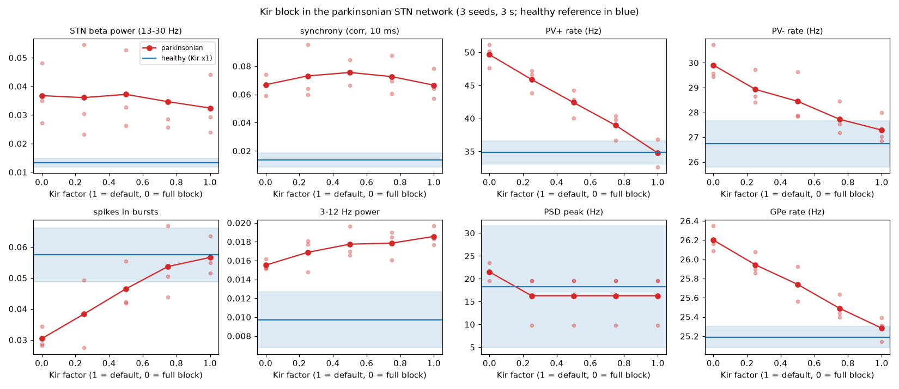
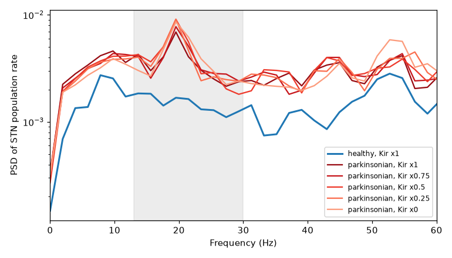

# Kir block with cortical beta (input_version 1), 2026-10-17

Model state: commit `e0d9960` on branch `claude/pensive-johnson-mdc58x` (inputs `cortical_arrivals.py` +
`gpe_feedback.py`). Reproduce with `python src/sweep.py run sweeps/kir_block_cortical_beta.py`
(the original runs used equivalent scratch scripts; results may differ slightly from a rerun because
coincident cortical events are now spaced 1 ns apart, see `stn_inputs.separate_coincident`).

## 1. Network tuning: a distinct parkinsonian state

Healthy vs parkinsonian differ only in the cortical input (`STATES` in `cortical_arrivals.py`:
parkinsonian = more shared drive, 20 Hz beta bursts at 0.7 modulation depth; same mean rate).
With the original network (STN->STN weight 0.001, 0.2 nS per cortical arrival) both states were
dominated by a loop-driven 6-8 Hz bursting rhythm and were indistinguishable.

Tuning grid (2 s runs, seed 1; `r1_*`, `r2_*` in `runs.csv`), parkinsonian / healthy ratios:

| cortex nS | STN->STN | GPe nS | healthy rate PV+/PV- (Hz) | beta | synchrony |
|---|---|---|---|---|---|
| 0.2 | 0.001 | 0.5 | 39 / 30 | 1.5x | 1.4x |
| 1.0 | 0.001 | 0.5 | 66 / 57 | 3.0x | 2.1x |
| 0.2 | 0.0002 | 0.5 | 18 / 8 | 0.95x | 0.4x |
| **1.0** | **0.0002** | **0.5** | **35 / 28** | **2.4x** | **3.7x** |
| 1.5 | 0.0002 | 0.5 | 44 / 38 | 4.0x | 6.4x |
| 2.0 | 0.0002 | 0.5 | 51 / 46 | 4.1x | 7.9x |
| 1.0 | 0.0002 | 1.0 | 32 / 20 | 1.7x | 2.8x |
| 1.5 | 0.0002 | 1.0 | 39 / 29 | 3.1x | 3.6x |

Chosen: cortex 1.0 nS, STN->STN 0.0002, GPe 0.5 nS. Confirmed on seeds 2-3 (3 s, `r3_*`):
beta 2.0-2.8x, synchrony 4.0-4.7x. Mean rates and bursting do not differ between the states.

## 2. Kir block in the parkinsonian network (3 seeds x 3 s; `k_*` in `runs.csv`)

Kir factor f multiplies both cell types' Kir (`cfg.channel_block = {'gKir': f}`).

| condition | beta power | synchrony | PV+ / PV- rate (Hz) | spikes in bursts |
|---|---|---|---|---|
| healthy (reference) | 0.013 | 0.014 | 35 / 27 | 0.06 |
| parkinsonian, f = 1 | 0.032 | 0.067 | 35 / 27 | 0.06 |
| f = 0.75 | 0.035 | 0.073 | 39 / 28 | 0.05 |
| f = 0.5 | 0.037 | 0.076 | 42 / 28 | 0.05 |
| f = 0.25 | 0.036 | 0.073 | 46 / 29 | 0.04 |
| f = 0 | 0.037 | 0.067 | 50 / 30 | 0.03 |

**Result:** Kir block does not restore the parkinsonian state when beta comes from cortex. Beta and
synchrony stay at parkinsonian levels (gap closed -0.1 to -0.25, within seed variability), the
20 Hz peak persists, and STN rates rise (PV+ 35 -> 50 Hz). Kir block depolarizes the cells (single
cells: PV+ 17 -> 39 Hz tonic, rebound burst size unchanged) but does not affect the synchronized
input that entrains them.
