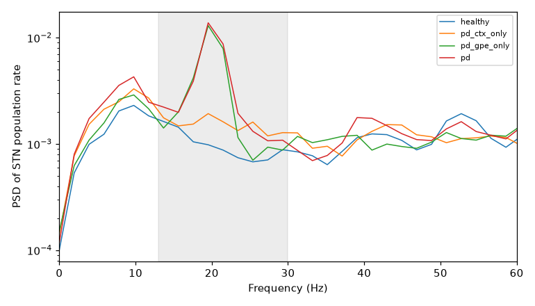
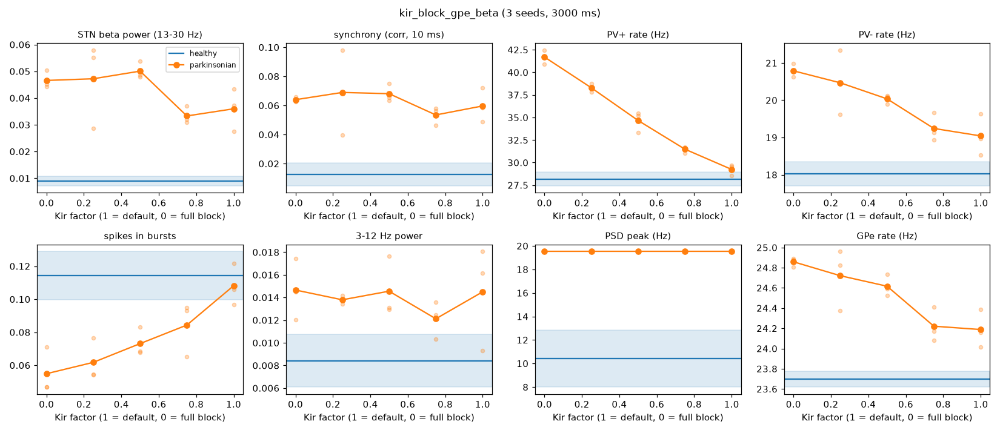
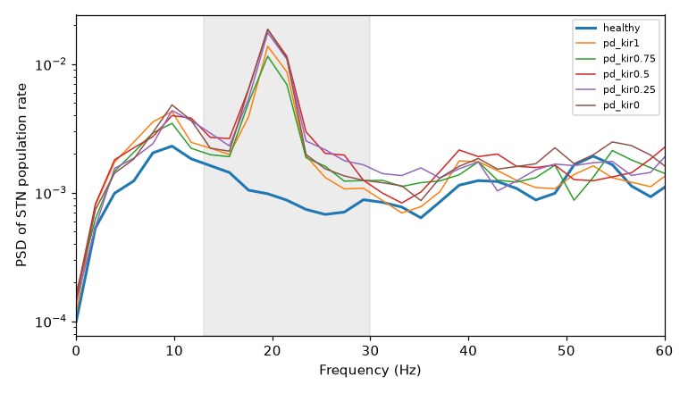

# Kir block with GPe as the primary beta source (input_version 2), 2026-10-17

Model state: commit `8396160` on branch `claude/pensive-johnson-mdc58x`. Reproduce with
```
python src/sweep.py run sweeps/beta_sources.py
python src/sweep.py run sweeps/kir_block_gpe_beta.py
```
All runs: 3 s, metrics from t >= 0.5 s, 3 seeds per condition.

## Inputs (v2)

- `gpe_feedback_v2.py`: the GPe output carries a 20 Hz beta modulation during beta bursts, shared by
  all GPe groups (common phase, small jitter); the mean GPe rate is unchanged.
  Parkinsonian: depth 1.0, bursts 2/s of 0.4 s; healthy: depth 0.1, 0.5/s of 0.15 s.
  Every GPe group projects to every STN cell; GABA decay 8 ms (`cfg.gpe_syn`), 0.5 nS per arrival.
- `cortical_arrivals_v2.py`: parkinsonian beta modulation 0.20 (v1: 0.70) and shared drive 0.10
  (v1: 0.25), so cortical beta and synchrony are a supplement; 1 nS per arrival.
- Network as in `results/kir_sweep_cortical_beta/` (STN->STN 0.0002, topography on).

Calibration: `sweeps/gpe_beta_tuning.py` (GPe conductance x GABA decay; with 35% GPe->STN
connectivity GPe alone gave <= 1.7x beta) and `sweeps/gpe_beta_tuning2.py` (full connectivity:
0.5 nS works, 1 nS brings back a slow loop rhythm). Parkinsonian GPe bursts were made more frequent
(1/s -> 2/s) because with 1/s some 3 s runs contained no GPe burst at all.

## 1. Which input carries the parkinsonian beta? (`beta_sources_*`)

| condition | beta power | synchrony | PSD peak | PV+ / PV- rate (Hz) |
|---|---|---|---|---|
| healthy | 0.0090 | 0.013 | ~10 Hz | 28 / 18 |
| parkinsonian cortex only | 0.0137 (1.5x) | 0.023 (1.9x) | ~10 Hz | 28 / 18 |
| **parkinsonian GPe only** | **0.0321 (3.6x)** | **0.046 (3.7x)** | **19.5 Hz** | 29 / 19 |
| parkinsonian (both) | 0.0360 (4.0x) | 0.060 (4.7x) | 19.5 Hz | 29 / 19 |

GPe accounts for most of the beta increase (~85%); cortex adds a little beta and some synchrony.
Mean rates and bursting do not differ between the states.



## 2. Kir block in the parkinsonian network (`kir_sweep_*`)

Kir factor f multiplies both cell types' Kir (`cfg.channel_block = {'gKir': f}`).

| condition | beta power | synchrony | PV+ / PV- rate (Hz) | spikes in bursts |
|---|---|---|---|---|
| healthy (reference) | 0.0090 | 0.013 | 28 / 18 | 0.11 |
| parkinsonian, f = 1 | 0.0360 | 0.060 | 29 / 19 | 0.11 |
| f = 0.75 | 0.0333 | 0.054 | 31 / 19 | 0.08 |
| f = 0.5 | 0.0501 | 0.068 | 35 / 20 | 0.07 |
| f = 0.25 | 0.0472 | 0.069 | 38 / 20 | 0.06 |
| f = 0 | 0.0466 | 0.064 | 42 / 21 | 0.05 |

Fraction of the parkinsonian-healthy gap closed (1 = healthy, < 0 = further away):
beta 0.10 / -0.52 / -0.42 / -0.39 and synchrony 0.13 / -0.18 / -0.20 / -0.09 for f = 0.75 / 0.5 / 0.25 / 0.




**Result:** with GPe as the primary beta source, Kir block again does not restore the parkinsonian
state. A 25% block changes beta and synchrony by ~10% of the gap (within seed variability); stronger
block increases STN beta power (partly because STN fires more: PV+ 29 -> 42 Hz) and leaves synchrony
and the 19.5 Hz peak unchanged. Bursting decreases below healthy levels. Kir block depolarizes STN
cells (single cells: PV+ 17 -> 39 Hz tonic, rebound burst size unchanged), which neither reduces
their entrainment by the beta-modulated GPe inhibition nor the STN hyperactivity.
