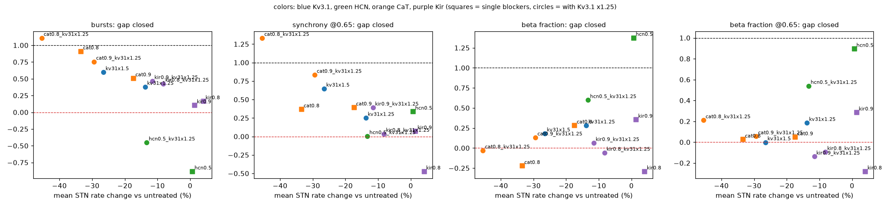
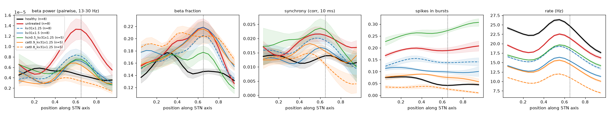

# Kv3.1 enhancement: more seeds, and combinations with HCN or CaT block, 2026-10-26

This uses the same network as `results/hcn_kv31_rescue/`: topographic, equal Kir 0.3 / 0.3, Kv3.1
PV+ 1.2 / PV- 1.15, cortex 0.8 nS, parkinsonian GPe->STN synapse scale 2.0 (model state: commit `12d704e`).

Sweep: `sweeps/kv31_combos.py` (3 s per run).
- Healthy, untreated, Kv3.1 x1.25 and x1.5: 8 seeds each.
- Single drugs and combinations: seeds 1-5. Their gaps are computed against healthy / untreated over
  the same seeds 1-5.
- Seeds 1-3 of the first group and of HCN 0.5 are the runs of `sweeps/hcn_kv31_rescue.py`.

Files:
- `summary.csv`, `summary.png` and `psd.png`: per-condition metrics and spectra.
- `profiles.png`: axis profiles, mean +- SEM.
- `profiles_all.png`: axis profiles of all conditions.
- `gap_vs_rate.png`: gap closed per symptom against the drop in mean STN rate.

## Results

"Gap closed" is 1 at healthy, 0 at untreated PD, and < 0 further away. Values after +- are the SD
across seeds of the per-seed gap. Seed-to-seed variability is large: a single healthy seed already
scatters +-0.5 in beta power, so only differences of ~0.5 or more are meaningful.

| condition | n | beta pow | beta frac | beta frac @0.65 | sync | sync @0.65 | bursts | PV+ / PV- rate (Hz) | spikes in bursts | beta peak at upper middle (0.5-0.75) |
|---|---|---|---|---|---|---|---|---|---|---|
| healthy | 8 | 1 | 1 | 1 | 1 | 1 | 1 | 38 / 20 | 0.054 | 3 / 8 |
| untreated PD | 8 | 0 | 0 | 0 | 0 | 0 | 0 | 33 / 16 | 0.177 | **8 / 8** |
| Kv3.1 x1.25 | 8 | 0.87 +- 0.85 | 0.28 +- 0.73 | 0.18 | 0.20 | 0.25 | 0.38 | 29 / 14 | 0.130 | 8 / 8 |
| Kv3.1 x1.5 | 8 | 1.17 +- 0.64 | 0.18 +- 0.52 | 0.00 | 0.56 | 0.65 | 0.60 | 25 / 11 | 0.104 | 5 / 8 |
| HCN 0.5 | 5 | 1.31 +- 0.69 | **1.37 +- 0.57** | **0.89** | 0.22 | 0.34 | **-0.88** | 33 / 17 | 0.298 | 3 / 5 |
| CaT 0.9 | 5 | 0.83 | 0.28 | 0.05 | 0.19 | 0.39 | 0.51 | 28 / 13 | 0.116 | 3 / 5 |
| CaT 0.8 | 5 | 0.85 | -0.22 | 0.02 | 0.08 | 0.37 | 0.91 | 23 / 10 | 0.064 | 4 / 5 |
| HCN 0.5 + Kv3.1 x1.25 | 5 | 0.92 +- 0.39 | 0.60 +- 0.13 | 0.54 | -0.12 | 0.00 | -0.45 | 29 / 14 | 0.241 | 3 / 5 |
| CaT 0.9 + Kv3.1 x1.25 | 5 | 1.18 | 0.13 | 0.06 | 0.60 | 0.83 | 0.75 | 24 / 11 | 0.084 | 5 / 5 |
| CaT 0.8 + Kv3.1 x1.25 | 5 | 1.53 | -0.03 | 0.21 | 0.79 | 1.33 | 1.11 | 19 / 8 | 0.037 | 1 / 5 |
| Kir 0.9 | 5 | 0.31 | 0.35 | 0.28 | -0.06 | 0.07 | 0.10 | 34 / 16 | 0.169 | 3 / 5 |
| Kir 0.8 | 5 | -0.45 | -0.29 | -0.28 | -0.36 | -0.47 | 0.16 | 35 / 17 | 0.161 | 4 / 5 |
| Kir 0.9 + Kv3.1 x1.25 | 5 | 0.76 | 0.06 +- 0.55 | -0.14 | 0.57 | 0.39 | 0.47 +- 0.15 | 30 / 14 | 0.121 | 3 / 5 |
| Kir 0.8 + Kv3.1 x1.25 | 5 | 0.30 | -0.06 +- 0.11 | -0.09 | 0.20 | 0.04 | 0.43 +- 0.16 | 31 / 14 | 0.126 | 5 / 5 |

## Interpretation

- **More seeds weaken the Kv3.1 x1.25 result.** With 8 seeds, x1.25 closes only ~0.3 of the
  beta-fraction gap (0.68 with 3 seeds) and ~0.4 of the burst gap. The beta peak stays at the upper
  middle in all 8 seeds. Most of the beta-power reduction is a rate effect (-13%).
  - x1.5 improves bursting (0.6) and synchrony (0.56) more, but the beta fraction stays
    parkinsonian (~0.2, 0 at the upper middle).
- **Two separate axes of rescue** (`gap_vs_rate.png`).
  - *Bursting and synchrony* normalize in proportion to how much STN firing is reduced, whichever
    drug reduces it. Kv3.1 increase, CaT block and their combinations all fall on one rate-dependent
    trend. Full burst normalization needs a ~35-45% rate drop.
  - *The beta spectrum* (beta fraction, upper-middle beta) is normalized only by HCN block, which
    leaves rates unchanged. Kv3.1 and CaT reduce beta power by reducing firing but leave the
    spectral shape and the upper-middle peak parkinsonian.
- **HCN 0.5 + Kv3.1 x1.25 shows no synergy.** It lands between its components: the beta fraction
  is ~0.6 closed (1.37 for HCN alone), bursting still worse than untreated (-0.45; -0.88 for HCN alone),
  and synchrony unchanged. Kv3.1 at x1.25 is too weak to cancel the HCN-induced burstiness.
- **CaT block + Kv3.1 x1.25 adds up along the rate trend.**
  - CaT 0.9 + Kv3.1 x1.25 closes 0.75 of the burst gap and 0.83 of upper-middle synchrony, at a
    ~28% rate drop (PV+ 24, PV- 11 Hz). The upper-middle beta peak stays in all seeds.
  - CaT 0.8 + Kv3.1 x1.25 normalizes bursting and synchrony and removes the beta peak, but halves
    the rates (19 / 8 Hz, vs healthy 38 / 20). This is suppression.

- **Slight Kir block + Kv3.1 x1.25** (added 2026-10-26; Kir is equal in both types, blocked in all
  STN cells). Kir block alone at 10-20% does nothing useful: bursting is barely changed, and at 0.8 beta
  and synchrony get worse.
  - Combined with Kv3.1 x1.25 it buys back part of the Kv3.1 rate cost: PV+ 30-31 / PV- 14 Hz,
    against 29 / 13.5 Hz for Kv3.1 alone and 33.5 / 16 Hz untreated.
  - Bursting improves slightly: 0.43-0.47 of the gap against 0.33 for Kv3.1 alone over the same
    seeds 1-5, within the seed SD of ~0.15. These points sit a little above the burst-vs-rate trend.
  - The Kv3.1 effect on the beta spectrum is lost: the beta-fraction gap goes from ~0.55 to ~0, and the
    upper-middle beta fraction gets slightly worse. With Kir 0.8 the beta peak stays at the upper
    middle in all seeds.
  - Upper-middle synchrony is not better than with Kv3.1 alone.
  - Net: slight Kir block makes Kv3.1 enhancement a little more rate-neutral, at the cost of its beta
    benefit, consistent with Kir block amplifying beta (\`results/kir_block_per_type/\`).

**Bottom line.** No single drug or tested pair restores all PD features in this model.
- The burst and synchrony features follow STN excitability; the beta-spectrum feature follows HCN.
- The most promising combination is therefore HCN block (for the spectrum) with a rate-reducing
  partner strong enough to cancel the HCN-induced bursting.
  - With Kv3.1 x1.25 the partner is too weak.
  - A stronger partner (Kv3.1 x1.5-2, or CaT 0.9 + Kv3.1 x1.25) costs ~30% of the firing rate.
