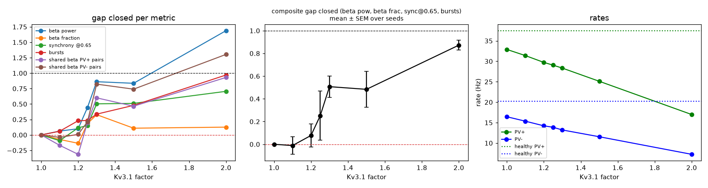
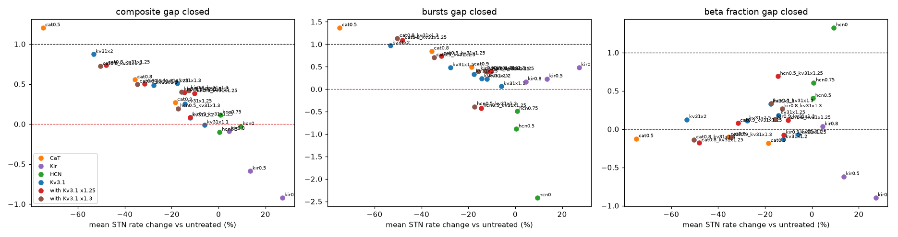

# Rescue sweep v2 on the current model: CaT / Kir / HCN block, Kv3.1 dose, combinations, 2026-10-27

## Model and design

The current default model (model state: commit `adc8379`):
- configuration D: GPe beta graded along the axis, topographic GPe<->STN (12 groups, sigma 0.1), 1 nS base;
- equal Kir 0.3 / 0.3, Kv3.1 PV+ 1.2 / PV- 1.15, cortex 0.8 nS;
- parkinsonian GPe->STN synapse scale 2.0;
- per-type GABA:glutamate ratio (`gpe_gaba_scale` PV+ 1.13 / PV- 0.87).

All factors act on all STN cells through `cfg.channel_block`. A Kv3.1 factor > 1 models a Kv3.1 opener.
Each condition is 5 seeds x 3 s (`sweeps/rescue_v2.py`). The healthy and untreated runs are those of
`sweeps/gaba_ratio.py`.
- **Stage 1:** single blocks, the Kv3.1 dose series, and combinations with Kv3.1 x1.25.
- **Stage 2:** the same combinations at Kv3.1 x1.3, the most consistent dose of stage 1.

Files:
- `gap_table.csv`: all gaps, composite +- SEM, rates, and the number of seeds with the beta peak at
  the upper middle.
- `kv31_dose.png`: Kv3.1 dose response.
- `gap_vs_rate.png`: composite, burst and beta-fraction gap against the change in mean STN rate.
- `summary.png`, `psd.png`, `summary.csv`: per-condition metrics and spectra.
- `make_figures.py`: regenerates the table and figures.

**Gap closed** is 1 at healthy, 0 at untreated PD, and < 0 further away. The **composite** is the mean
gap over beta power, beta fraction, synchrony at axis 0.65 and burst fraction, computed per seed;
+- is the SEM over seeds. "PV+ / PV- pairs" is the shared (pairwise) beta between cells of that type.
Untreated PD vs healthy: PV+ 32.9 / PV- 16.4 Hz vs 37.5 / 20.3 Hz, bursts 0.161 vs 0.046.

## Results

| condition | beta pow | beta frac | sync @0.65 | bursts | PV+ pairs | PV- pairs | **composite** | rate change | PV+ / PV- (Hz) |
|---|---|---|---|---|---|---|---|---|---|
| CaT 0.9 | 0.42 | -0.19 | 0.36 | 0.49 | 0.47 | 0.09 | 0.27 +- 0.14 | -19% | 27.8 / 13.1 |
| CaT 0.8 | 1.02 | -0.10 | 0.45 | 0.85 | 0.65 | 0.89 | 0.55 +- 0.12 | -36% | 22.6 / 10.2 |
| CaT 0.5 | 2.25 | -0.12 | 1.32 | 1.37 | 1.38 | 1.53 | 1.21 +- 0.14 | -75% | 9.1 / 3.9 |
| Kir 0.8 | -0.29 | 0.03 | -0.26 | 0.17 | 0.14 | -0.59 | -0.09 +- 0.17 | +4% | 34.5 / 17.1 |
| Kir 0.5 | -1.54 | -0.62 | -0.42 | 0.23 | -1.27 | -1.54 | -0.59 +- 0.21 | +14% | 37.0 / 18.8 |
| Kir 0 | -2.64 | -0.90 | -0.63 | 0.48 | -1.96 | -2.68 | -0.92 +- 0.33 | +27% | 40.5 / 21.3 |
| HCN 0.75 | 0.45 | 0.60 | -0.10 | -0.49 | -0.22 | 0.53 | 0.12 +- 0.18 | +1% | 33.4 / 16.5 |
| HCN 0.5 | 0.31 | 0.40 | -0.23 | -0.89 | -0.42 | 0.41 | -0.10 +- 0.13 | 0% | 32.9 / 16.6 |
| HCN 0 | 1.01 | **1.33** | -0.05 | **-2.42** | 0.74 | 1.01 | -0.03 +- 0.12 | +9% | 33.8 / 18.5 |
| Kv3.1 x1.1 | 0.06 | -0.07 | -0.09 | 0.06 | -0.17 | -0.04 | -0.01 +- 0.08 | -6% | 31.4 / 15.3 |
| Kv3.1 x1.2 | 0.10 | -0.14 | 0.12 | 0.23 | -0.31 | 0.01 | 0.08 +- 0.10 | -12% | 29.7 / 14.2 |
| Kv3.1 x1.25 | 0.44 | 0.18 | 0.15 | 0.23 | 0.20 | 0.21 | 0.25 +- 0.21 | -14% | 29.1 / 13.9 |
| **Kv3.1 x1.3** | **0.86** | 0.33 | **0.50** | 0.34 | 0.60 | **0.82** | **0.51 +- 0.09** | **-18%** | 28.3 / 13.2 |
| Kv3.1 x1.5 | 0.84 | 0.11 | 0.51 | 0.48 | 0.47 | 0.74 | 0.48 +- 0.16 | -28% | 25.1 / 11.6 |
| Kv3.1 x2 | 1.69 | 0.13 | 0.71 | 0.97 | 0.93 | 1.30 | 0.87 +- 0.04 | -53% | 17.0 / 7.2 |
| CaT 0.9 + Kv3.1 x1.25 | 0.97 | 0.08 | 0.23 | 0.74 | 0.33 | 0.84 | 0.50 +- 0.15 | -32% | 23.9 / 10.9 |
| CaT 0.8 + Kv3.1 x1.25 | 1.28 | -0.18 | 0.77 | 1.09 | 0.60 | 0.96 | 0.74 +- 0.12 | -48% | 18.6 / 8.1 |
| Kir 0.9 + Kv3.1 x1.25 | 0.08 | -0.08 | -0.04 | 0.39 | 0.18 | -0.11 | 0.09 +- 0.08 | -12% | 29.6 / 14.3 |
| Kir 0.8 + Kv3.1 x1.25 | 0.48 | 0.11 | 0.54 | 0.39 | 0.40 | 0.25 | 0.38 +- 0.08 | -10% | 30.0 / 14.6 |
| HCN 0.5 + Kv3.1 x1.25 | 0.98 | 0.69 | 0.34 | -0.43 | 0.70 | 0.80 | 0.40 +- 0.12 | -15% | 28.6 / 13.9 |
| CaT 0.9 + Kv3.1 x1.3 | 0.92 | -0.11 | 0.48 | 0.70 | 0.58 | 0.53 | 0.50 +- 0.12 | -35% | 23.0 / 10.3 |
| CaT 0.8 + Kv3.1 x1.3 | 1.38 | -0.14 | 0.52 | 1.13 | 0.53 | 1.06 | 0.72 +- 0.07 | -50% | 18.1 / 7.7 |
| Kir 0.9 + Kv3.1 x1.3 | 0.56 | 0.13 | 0.53 | 0.40 | 0.06 | 0.49 | 0.40 +- 0.14 | -16% | 28.9 / 13.6 |
| Kir 0.8 + Kv3.1 x1.3 | 0.64 | 0.27 | 0.36 | 0.40 | 0.17 | 0.65 | 0.42 +- 0.21 | -13% | 29.6 / 14.1 |
| HCN 0.5 + Kv3.1 x1.3 | 0.76 | 0.33 | 0.07 | -0.39 | 0.27 | 0.64 | 0.20 +- 0.18 | -17% | 27.6 / 13.5 |

## Interpretation

**Single blocks.** These repeat the pattern of the earlier networks.
- **Kir block** is counterproductive for beta and synchrony. It raises rates (+27% at full block) and
  sharply increases the beta shared between PV- pairs (gap -2.7). Only bursting improves, because
  faster tonic firing leaves fewer pauses.
- **HCN block** is the only intervention that normalizes the beta spectrum (beta fraction 1.33 at full
  block, at unchanged rates). It does not reduce synchrony, and bursting becomes much worse (-2.4),
  so the composite stays at ~0.
- **CaT block** improves everything except the beta fraction, but only by suppressing firing: -36% rate
  at CaT 0.8, -75% at CaT 0.5.

**Kv3.1 dose: x1.3 is now a better dose than x1.25.**
- x1.25 improves on average (composite 0.25) but very unevenly across seeds (-0.36 to +0.78).
- x1.3 improves every seed (0.51 +- 0.09) for an 18% rate drop. At that dose:
  - beta power is 0.86 closed, upper-middle synchrony 0.50 and bursts 0.34;
  - shared beta is 0.82 closed for PV- pairs and 0.60 for PV+ pairs.
- Higher doses add little per unit of rate loss: x1.5 gives 0.48 at -28%, x2 0.87 at -53%.
- On the composite-vs-rate plot, x1.3 sits clearly above CaT block at the same rate cost (CaT 0.9:
  0.27 at -19%). It is the most rate-efficient single intervention tested.
- Kv3.1 never normalizes the beta fraction (<= 0.33), so the spectral shape stays parkinsonian.
- The response from x1.2 to x1.3 is steep, so the exact optimum depends on the model's calibration.

**Combinations: none beats Kv3.1 x1.3 alone.**
- **CaT + Kv3.1** gains more only at a larger rate cost, and sits on the same rate trend:
  - CaT 0.9 + x1.3: 0.50 at -35%;
  - CaT 0.8 + x1.3: 0.72 at -50%.
- **Slight Kir block + Kv3.1 x1.3** gives a similar composite to x1.3 alone (0.40-0.42 vs 0.51) and
  buys back a few % of rate (-13 to -16% vs -18%). At x1.25, Kir 0.9 and 0.8 disagree (0.09 vs 0.38),
  so the Kir partner effect is within seed noise.
- **HCN 0.5 + Kv3.1** keeps part of HCN's beta-fraction benefit (0.69 at x1.25), but bursting stays worse
  than untreated (about -0.4), even at x1.3. Kv3.1 at these doses cannot cancel HCN-induced bursting.

**Bottom line.**
- On the current model, Kv3.1 enhancement at ~x1.3 is the best rate-efficient rescue: about half of
  the PD gap closed across beta power, upper-middle synchrony and bursting, for an 18% rate drop.
- No tested partner improves on it without paying in rate (CaT) or in bursting (HCN).
- The beta-spectrum shape (beta fraction) is normalized only by HCN block, which conflicts with the
  burst symptom. That conflict remains unsolved.
