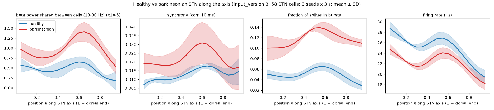

# Topographic parkinsonian state (input_version 3), 2026-10-18

Goal: a parkinsonian STN that bursts more than healthy STN, with beta power and synchrony peaking
in the upper-middle STN (axis ~0.65; axis = (xnorm + ynorm) / 2, 1 = dorsal end).

## Model changes (commit `94669cf` / `87b2bb3`, defaults in `src/cfg.py`)

- **Topographic GPe<->STN** (`src/gpe_feedback_v3.py`, `cfg.input_version = 3`). There are 12 GPe
  groups with home positions spread along the axis. A group inhibits STN cell i with probability
  exp(-(axis_i - c_g)^2 / (2 * 0.1^2)), so each STN cell gets input from ~3 nearby groups instead of
  all 12. STN feedback to GPe uses the same Gaussian, giving local reciprocal loops.
- **Parkinsonian beta drive graded along the axis.** Modulation depth is 1.0 at axis 0.65
  (Gaussian width 0.15) and falls to 0.2 elsewhere. There are 2 bursts/s of 0.4 s each.
  The healthy state has weak (0.1), uniform and brief beta episodes.
- **Stronger GPe->STN synapses.** These replace Kv3.1 differentiation, which made PV+ and PV-
  converge (`results/kv31_single_cell/`).
  - Base conductance is 1 nS (`cfg.gpe_conductance_nS`; it was 0.5 nS with all-to-all input).
  - The parkinsonian state adds `synapse_scale` 1.5, modelling the strengthened GPe-STN synapses
    after dopamine depletion (Fan et al. 2012).
- **Cortical conductance 0.7 nS** (`cfg.ctx_overrides`). This brings rates back to ~30 / 20 Hz
  after the topographic GPe input changed the balance.
- **Network doubled** to `cfg.pop_order = 60` (58 STN cells).
- **Axis profiles** in `src/network_metrics.py`:
  - pairwise beta cross-power (independent of local cell count), synchrony, burst fraction and rate
    along the axis, using a Gaussian kernel of 0.12;
  - peak positions only where n_eff >= 5.
- K_ATP stays off; Kv3.1 scales stay at 1.0.

Old sweep specs are pinned to their previous settings (input_version 2, pop_order 30, GPe 0.5 nS,
default cortex), so they reproduce their published results.

## Calibration grid (`sweeps/topo_pd_tuning.py`; 1 seed x 3 s; cortex 1 nS) -> `tuning_summary.csv`

| topo_sigma | GPe base (nS) | state (synapse_scale) | beta pow | sync | PV+ / PV- rate (Hz) | bursts |
|---|---|---|---|---|---|---|
| 0.10 | 1 | healthy | 0.024 | 0.009 | 39 / 30 | 0.07 |
| 0.10 | 1 | **PD 1.5** | **0.049** | **0.020** | **36 / 26** | **0.15** |
| 0.10 | 1 | PD 2.5 | 0.035 | 0.013 | 34 / 22 | 0.29 |
| 0.10 | 2 | healthy | 0.017 | 0.004 | 35 / 23 | 0.22 |
| 0.10 | 2 | PD 1.5 | 0.034 | 0.016 | 34 / 21 | 0.32 |
| 0.15 | 1 | healthy | 0.023 | 0.012 | 35 / 24 | 0.12 |
| 0.15 | 1 | PD 1.5 | 0.047 | 0.025 | 32 / 20 | 0.20 |
| 0.15 | 2 | healthy / PD 1.5 | 0.015 / 0.029 | 0.007 / 0.011 | 33 / 18, 33 / 16 | 0.31 / 0.42 |

Findings from the grid:
- GPe 2 nS makes even the healthy state bursty (0.22-0.31).
- Synapse scale 2.5 increases bursting but reduces beta.
- σ = 0.15 broadens the beta hump.
- σ = 0.1 with GPe 1 nS and PD scale 1.5 gives the best contrast.

## Confirmation (`sweeps/topo_pd_confirm.py`; 3 seeds x 3 s) -> `confirm_summary.csv`

| cortex | state | beta pow | sync | PV+ / PV- rate (Hz) | bursts | beta peak (axis) | sync peak (axis) |
|---|---|---|---|---|---|---|---|
| 0.7 nS (default) | healthy | 0.024 +- 0.001 | 0.009 | 33 / 23 | 0.05 | scattered, low hump | scattered |
| 0.7 nS (default) | **PD** | **0.041 +- 0.006** | **0.019** | **31 / 20** | **0.12** | **0.65, 0.65, 0.60** | **0.60, 0.60, 0.60** |
| 1 nS | healthy | 0.025 | 0.009 | 40 / 30 | 0.08 | | |
| 1 nS | PD | 0.048 | 0.020 | 37 / 26 | 0.14 | one seed without an upper-middle hump | |



`profiles.png` shows healthy vs PD profiles along the axis (mean +- SD over 3 seeds, cortex 0.7 nS;
the dashed line is axis 0.65). `psd_confirm.png` shows the STN population PSDs.

- **Burstier.** The PD state bursts 2.4x more than healthy (0.12 vs 0.05 of spikes in bursts), and
  more along the whole axis (the PD burst profile peaks ~0.55).
- **Upper-middle peak.**
  - PD beta power peaks at axis 0.60-0.65 in every seed. There it is 2.2x healthy, against 1.7x for
    the whole population.
  - PD synchrony peaks at 0.60 and is 1.8x healthy there.
  - Beta and synchrony therefore follow the same gradient.
- **Rates.** Firing rates fall slightly in PD (PV+ 33 -> 31 Hz, PV- 23 -> 20 Hz) because of the
  stronger inhibition.

Caveats:
- The healthy state also shows a small, lower beta hump. The topography is the same in both states,
  and the weak healthy beta episodes are spatially uniform but still filtered by the local loops.
- PV+ rates are slightly above 30 Hz.
- 3 s runs with 3 seeds are enough for the peak positions but leave ~15% SD on PD beta power.

Reproduce:

```
python src/sweep.py run sweeps/topo_pd_confirm.py
python src/sweep.py summary sweeps/topo_pd_confirm.py
```
